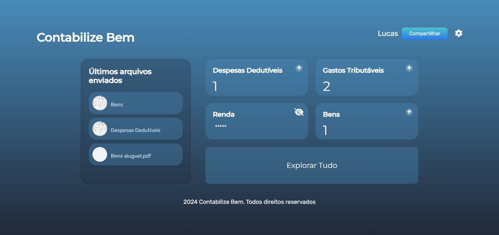
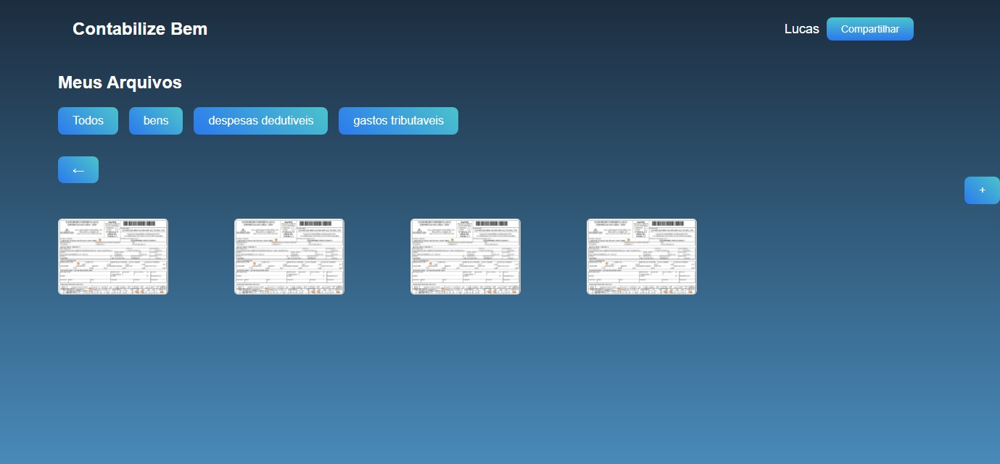
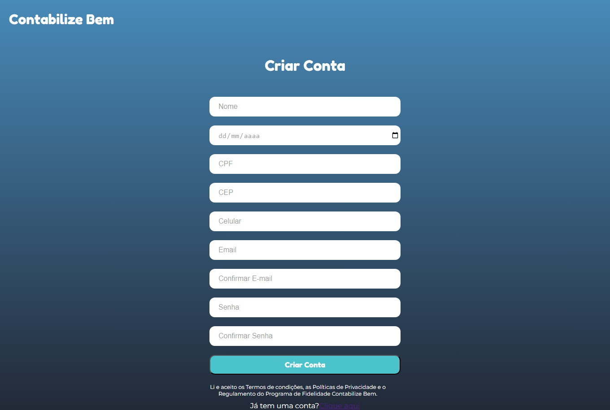
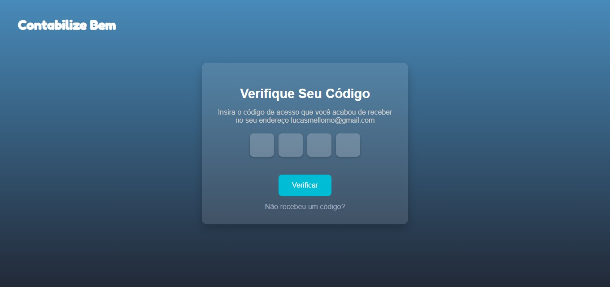
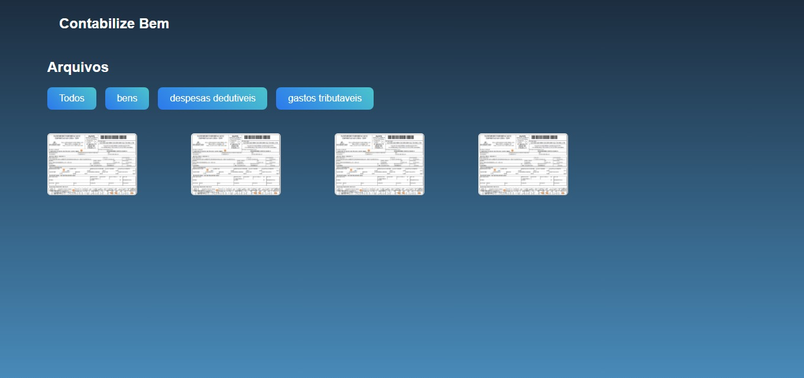
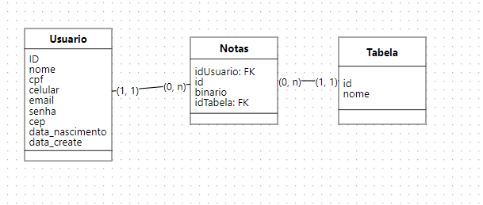
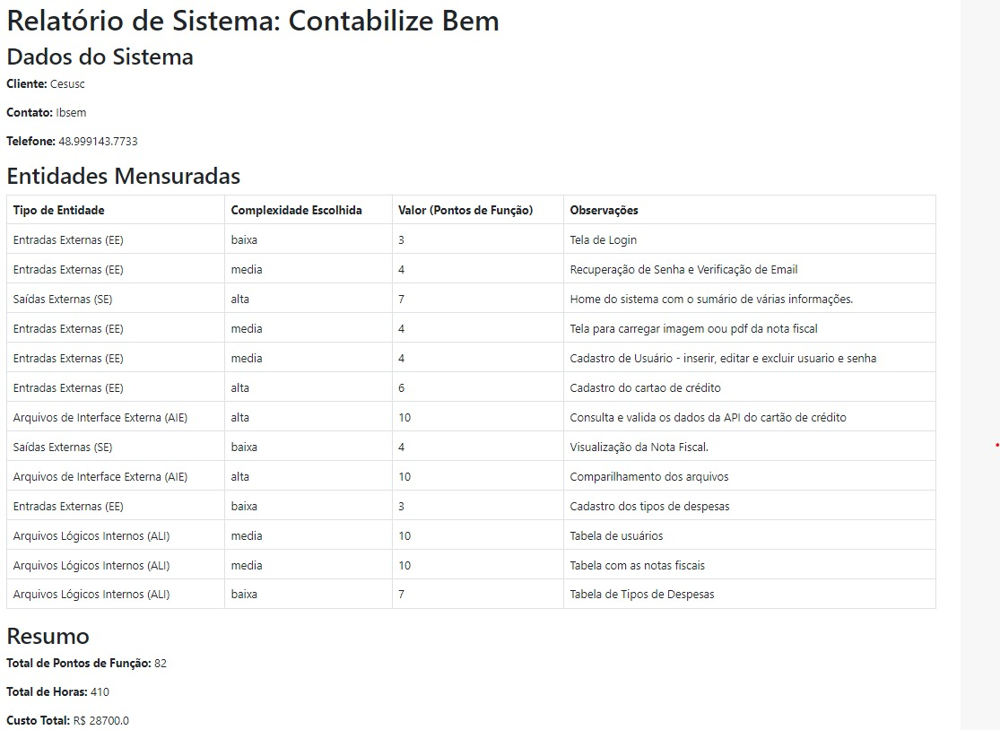

# Contabilize Bem - PMI
## Link: [contabilizebem](https://contabilizebem.squareweb.app)

## A web app for organizing income tax documents and personal finances 
## throughout the year, making it easier to prepare your annual tax return 
## and share documents with your accountant.

## Problem

## Keeping track of receipts, income, and tax-related documents across the 
## year is painful. Most people either lose documents or scramble to find 
## everything at tax season.

## Solution

## A centralized platform where users can store, organize, and share their 
## financial documents year-round. Built as a final degree project (equivalent 
## to a thesis) at UNICESUSC.

## Features

- User authentication with email verification
- Document and receipt storage organized by category
- Shareable links so users can send documents directly to their accountant
- Clean dashboard to track financial records over time

## Tech Stack

- **Backend** — Python, Flask
- **Database** — SQL (ORM with modeled schema)
- **Frontend** — HTML, CSS, JavaScript
- **Deploy** — Squareweb

---

## Screenshots

### Main page (`/`)


### Home (`/home`)


### Notes (`/notas`)


### Login (`/login`)


### Create Account (`/criar_conta`)


### E-mail Verification (`/verify_email`)


### Shared (`/compartilhado`)


---


## Getting Started
```bash
pip install -r requirements.txt
python app.py
```


## Database Model:




## Function Point:



## Team:

- Lucas Mello:  
[Github](https://github.com/LucasMe110)  
[Linkedin](https://www.linkedin.com/in/lucas-mello-muller-de-oliveira-5a0b24225/)

- Pedro Renner:  
[Github](https://github.com/RennerPedro)  
[Linkedin](https://www.linkedin.com/in/pedro-henrique-renner-030619213/)

- Nicolas Santos:  
[Github](https://github.com/nicoolassantos)  
[Linkedin](https://www.linkedin.com/in/nicolas-santos-0141362a0/)

- Eduardo Smyk:  
[Github](https://github.com/Eduardosmyk)  
[Linkedin](https://www.linkedin.com/in/eduardo-smyk-ba0a1a1b9/)
